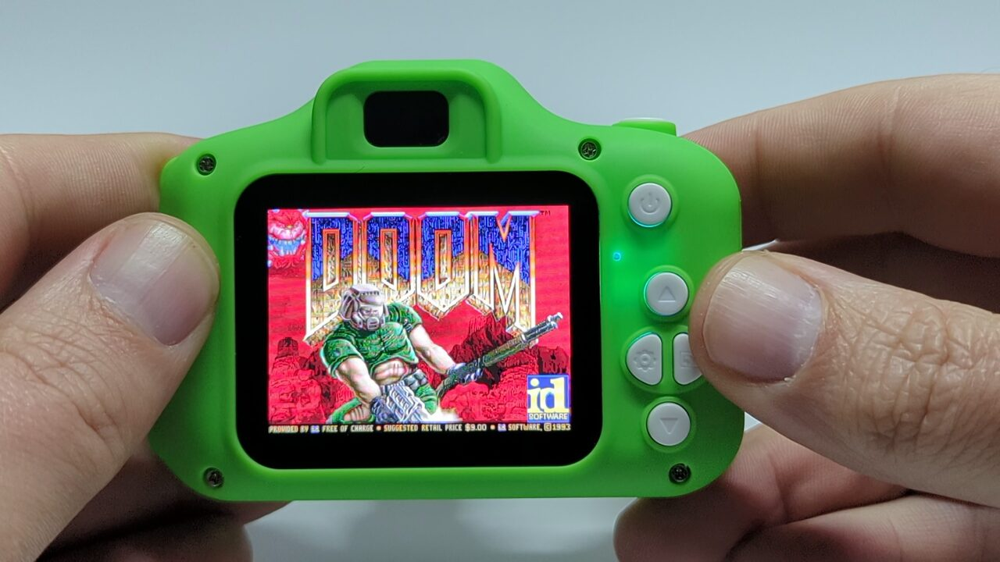
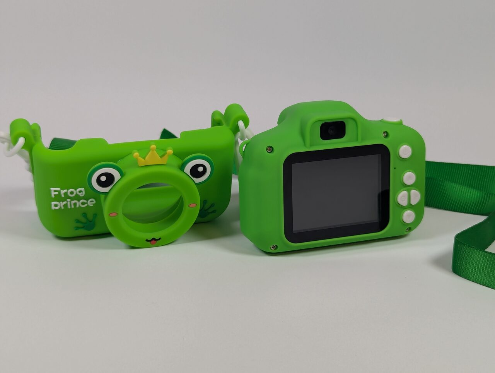
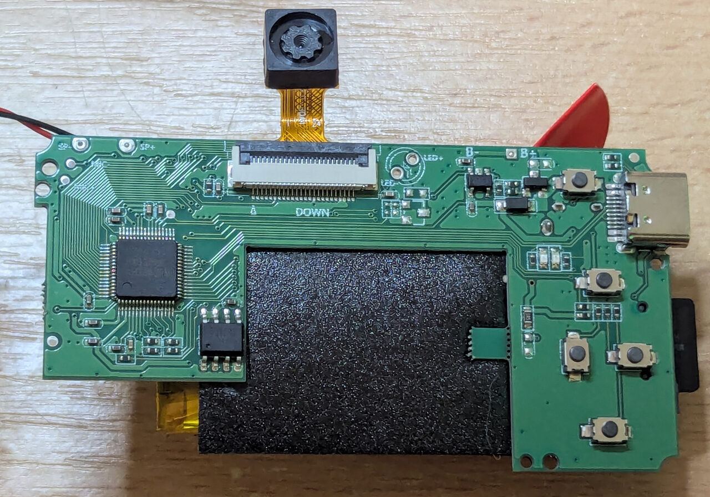
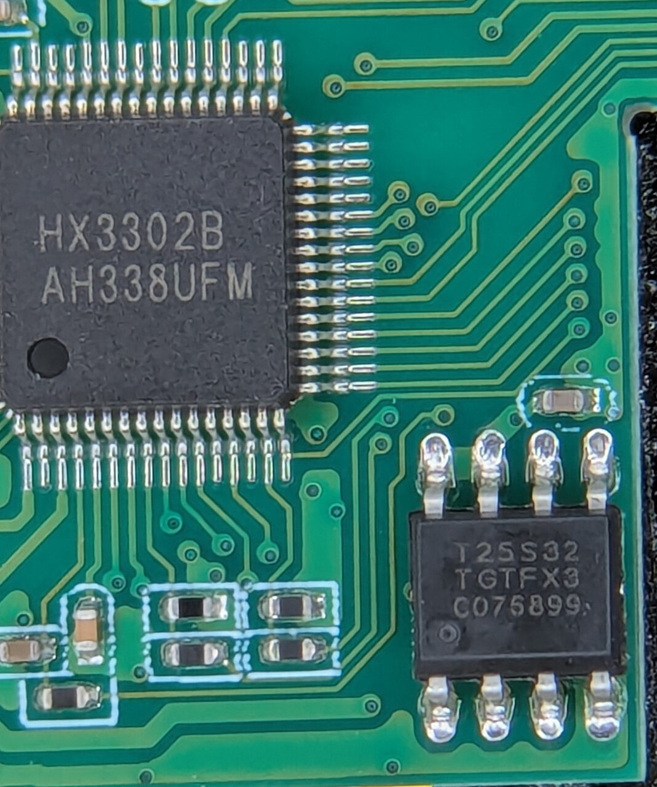
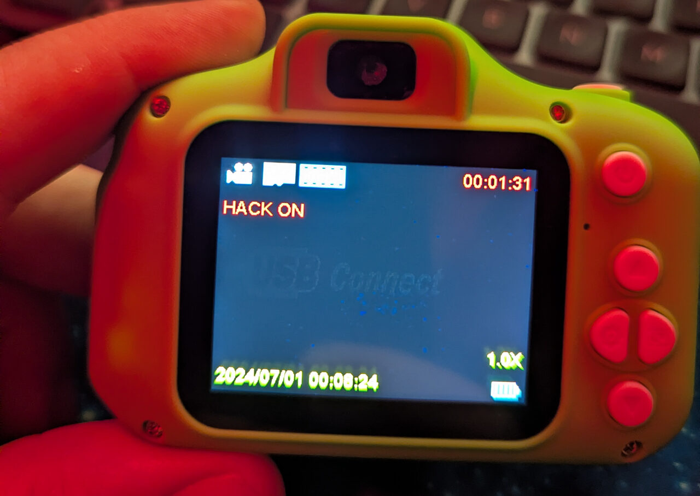
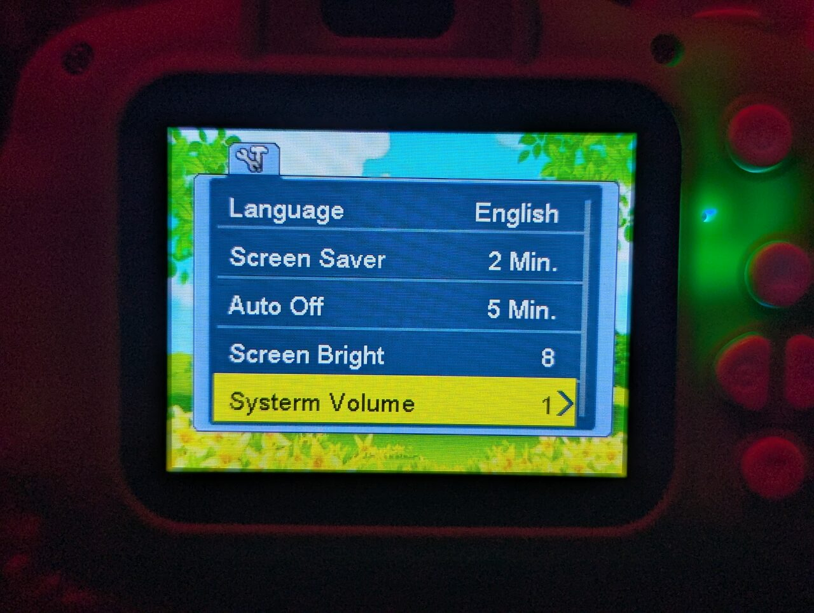
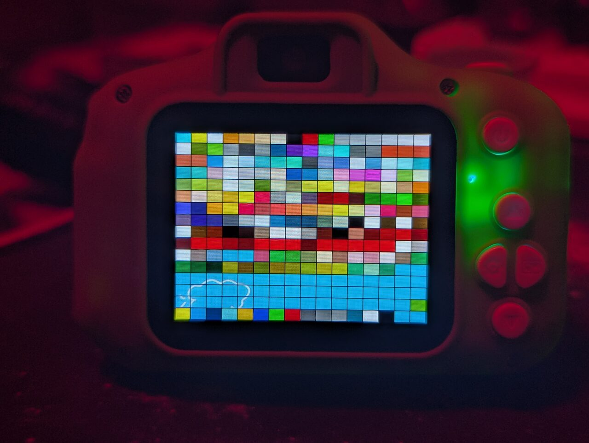

What started as a curious "I wonder what firmware this camera runs?" ended up as two days and some late nights of reverse engineering an entirely undocumented SoC (system on a chip), building an SDK, a local emulator, a custom compiler and a fully ported version of Doom that runs on a camera with **just 891K of available RAM** - whilst still fully functioning as a camera.

To be clear, this isn't just Doom for the sake of Doom. The controls are mapped well enough that you can actually play it, all the sounds work, there's chiptune music, you can save and load your game, and it runs at around 30fps. This is Doom in your pocket.

Has this been done before? It would be easier to ask what Doom *hasn't* been ported to, but the only two similar examples I can find are [Ilya Kurdyukov's video](https://youtu.be/fcUInR3Cl8g), where the chip (a Spreadtrum SC6531) has 4-8MB of RAM and he doesn't disclose anything about how it was done, and [this LGR video](https://www.youtube.com/watch?v=7gCZZkBATSc), where it's basically a full computer, again with plenty of RAM and a full SDK for developing the software. This was a far more significant challenge.

I chose to fully document everything on [GitHub](https://github.com/andrewspode/hx3302b-x9s-camera) - a detailed analysis of how the firmware and chip work, a tool for pulling the firmware off your own camera over USB, the SDK, the compiler patches and the Doom port. So you can do this yourself, or take the same techniques and apply them to something similar. This article is the story of how we got there - the repo is how you can get there too.

## The Camera

This is the camera. The box told us nothing - no manufacturer, no address, no name, and there's nothing in the UI either. It's like it's been made to be sold on under as many brands as possible without anyone having to take responsibility for it. The only identifier is the model in the manual, X9S.

The USB IDs brought up nothing either. This thing was practically invisible online, other than AliExpress listings from people selling them.

Then I looked at one of the photos it had taken and got a hit from the EXIF data - the maker was listed as "HX-Tech" - which led me to an article by Sprite_tm (Jeroen Domburg) called [Kid-cam firmware modding](https://spritesmods.com/?art=kid_cam). It was a slightly different camera running quite different firmware, and the changes he wanted to make were minimal. However, his work gave us some good starting information (what kind of CPU to expect, for one), but it wasn't enough, and I was going to have to open the device up if I wanted to make any more progress.

## Inside

I was hesitant to open it up as my daughter loves it and I really didn't want to break it, but at this point I was too invested. Out came the soldering iron to remove the battery so I could work on it safely.

Inside I found the model of the chip (HX3302B), which I couldn't find any other reference to anywhere, and an 8-pin flash memory chip. Reading that chip was the key to everything, and I was lucky to have the right tool on hand - an XGecu T48 programmer, which I use quite regularly when repairing motherboards. You'd be surprised how common bitrot is on 20+ year old boards.

I have a clip that goes over the top of the chip so you don't have to desolder it from the board, but they're a pain to get on and often don't stay put. In this instance I had to hold it in place with both hands and use my little finger to hit the mouse button to read the memory. This took several attempts, and only when I had three reads that were identical did I trust that I didn't have any read errors.

Having this dump is where the real work began.

## Claude Steps In

Having recently spent quite some time on a 100% byte-matching decompile of [Indiana Jones and the Infernal Machine](https://github.com/andrewspode/infernal-machine-decomp-public) as part of helping the [OpenJones](https://github.com/smlu/OpenJones3D) project, I was very aware of how powerful AI can be at decompiling and reverse engineering - but also of its shortcomings and how to get the best out of it.

That knowledge came in handy, and it wasn't long before Claude and I had [Ghidra](https://en.wikipedia.org/wiki/Ghidra) up and running and the firmware being pulled apart into its constituents. That was thanks to Sprite, who had already worked out the CPU and published a [Ghidra processor definition](https://github.com/Spritetm/ghidra-or1k-le-hack) for it. We quickly spotted that, despite the chips being similar, our firmware was very different - the update file, for one, was called `Xly100s.bin` rather than Sprite's `hx330x_sdk.bin`.

## Flashing Our First Change

We already knew from Sprite's article that these cameras can update themselves from a file on the SD card. Reading through the firmware's code, the first new thing we learned about the process was how it writes, and specifically that it does a *partial* update - it starts at the beginning of the flash and writes for as long as your file is. So if you supply a 1MB file, it flashes the first 1MB and leaves the other 3MB alone. That mattered, because it meant we could make small, targeted changes and only rewrite as much of the flash as we had to, leaving everything after it alone.

Having the T48 on hand meant we always had an emergency way home - we could flash the original firmware straight back - but it was fiddly work, and we wanted to avoid it. Updating from the SD card was far easier.

Additionally, although the header has a checksum, the camera never checks that it's correct. All you had to do was change the header timestamp by a second and that was in theory enough to trigger the flash. According to the code, the update check runs every time you switch the camera on.

So we started with no real change at all - just the first few KB of the flash with the header timestamp altered. The aim was to trigger the flash and see the update screen, to know we were on the right path, and since we were only changing the timestamp, it was about as safe as a flash can be.

We were expecting the version screen to show the new timestamp, but it didn't, and as far as we could tell nothing had happened. So we spent quite some time looking for secret triggers.

During that process I discovered that if you held the shutter down on the battery screen for 5 seconds, it went to a special test mode where it said "TEST ON". We found this reference in the firmware and changed it to read "HACK ON". As this file was a lot larger, at around 770KB, we finally got a progress bar - and when we went back into the test mode, there it was:

The hack was indeed on - and we had been sent on a wild goose chase. Our earlier updates *were* working, they were just so small that the progress bar never had time to appear and our changes didn't make any visible difference we could spot.

## EXIF to the Rescue

Now that we had a way of flashing updates, we wanted to make our first real code change. We chose the EXIF trick, a clever method Sprite had used on his camera, because it would give us valuable insight into the device before we started making more serious changes.

If you haven't come across it, EXIF is a block of information stored at the very start of a photo file - things like which camera took it, when, and with what settings (on a phone it usually includes where, too). A JPEG can reserve up to 64KB for it, and this camera only uses around 730 bytes, about 1% of that, so there's a lot of spare space that nothing is looking at.

Sprite's idea was to use that space as a dumping ground for the camera's memory. You change the code that writes the photo's metadata so it writes a slice of the camera's own memory instead, then read it back off the SD card, inside the photo.

On its own, the trick can dump up to 64KB per photo, and for the camera's main RAM that worked first time - one photo, one big chunk. But it didn't work for the memory we most wanted to see, the camera's small internal start-up memory. The photo is written to the SD card by a hardware engine that can't see that memory, so all we got back was zeros. We had to make the camera's own CPU copy the memory into the photo instead, and there was only room for 4KB at a time, so we made it iterative. A counter kept in the camera's memory moved the window along each time, so every photo captured the next 4KB. Take 16 photos and you've dumped all 64KB, read straight off the SD card.

That gave us a lot. The camera's internal memory matched the start of our firmware dump byte for byte, and so did part of its main RAM, so we knew those parts of the dump were good. It also showed that the code the firmware calls into, which we'd assumed was hidden in a ROM, was just part of the flash's own start-up code, so everything the camera runs was already in our dump. (It also exposed a mistake of ours - the "ROM" we kept trying to read came back as nothing but zeros, because we'd been working out the addresses wrongly. The memory dump is what finally let us put that right.) And by probing a megabyte at a time, we found out how much RAM the camera has - when we asked for the third megabyte, it reset. Two megabytes, then. But it only told us so much. It gave us a map of the camera's memory, not a view of what the code was actually doing, so to really understand the firmware we had to start digging into the code itself.

## Our First Fix

With a working flash method and a map of the camera's memory, the question was what to reverse engineer first. One thing seemed like an obvious candidate, and I got a lot of satisfaction out of it as it had always bugged me. If you go into the camera's settings, one of the menu items reads "Systerm Volume". You'd think fixing a typo would be easy - search for the text, change it, done. Except the text isn't in the firmware as text. Searching for it finds nothing, in any encoding.

It turns out the camera has its own bitmap font with several hundred glyphs in it (Latin, Cyrillic, Thai, Chinese, Korean, Arabic...) and every string in the menu is stored as a list of glyph numbers, for each of the 18 languages it supports. We had to work out the format of those tables, write a script that drew the strings using the camera's own font so we could see what we were looking at, and then find the English string. One step closer to understanding the code, and an annoying typo was fixed.

## Now We Test

That first fix gave us confidence, so we started pulling the firmware apart properly, just trying to understand how it fitted together. We quickly found the area the games ran from, and this seemed the safest place to start writing larger chunks of code. Nothing in there runs until you open the Games menu, and the firmware update check runs as soon as the camera switches on, so however badly we broke things, we'd always have a way back.

Still writing assembly at this point, we wrote a series of small programs and benchmarks to capture information such as button presses, how much of the RAM was actually free, how things were laid out, how fast the RAM could be read and written, how fast the CPU was, and how we could interact with the display.

Once the results were in, we finally knew what we were working with:

- **CPU:** ~120 MIPS (millions of simple instructions per second) at best, or ~82 if there's a branch every few instructions
- **L1 cache:** 8KB for instructions and 8KB for data, read and written at ~164MB/s
- **RAM:** 2MB, read at ~65MB/s and written at ~37MB/s. Just 891K of it was free for our own use
- **Flash:** 4MB (the chip holding the firmware), read at only ~4.4MB/s. Code that fits in the instruction cache runs as fast from flash as from RAM, but code that doesn't runs about 18 times slower
- **Display:** 320x240 with 256 colours, and a palette we could change

Although not directly comparable, that comes out similar to a 486 DX4/100, which manages roughly 100 MIPS, and the memory speed is close to what you'd expect from an early Pentium.

In other words, we were looking at something like a fast 486 with the memory speed of a Pentium - and with less than 1MB of RAM to spend.

At that point I was questioning what my end goal with this device was at all. But looking at those numbers, I snorted and posed the question - do you think we could run Doom? The specs looked very similar to machines that ran it happily at the time, just without the full 4MB of RAM it required. We had half that, and most of it was already in use.

## Porting Doom

We started with [doomgeneric](https://github.com/ozkl/doomgeneric), a version of Doom designed to be easy to port to all kinds of stupid devices like our camera. You provide a few functions (draw a frame, read a key, tell the time) and it does the rest.

Because we already had our own compiler and emulator, porting the code to our particular flavour of OpenRISC was fairly trivial. The real issue was how little memory we had to work with. Doom was designed for a machine with 4MB, but the camera only has 2MB, and only 891K of that is free once the firmware has taken its share. That has to hold two different things: the game's code, and its working memory - the textures, levels and sounds it loads and juggles while you play.

### Finding More RAM

The working memory is the bigger problem, because Doom constantly allocates from a large pool of it while the game runs. So we went looking for more. We wrote a simple stand-in program that did everything the game would need to do - play sounds, read the keys, draw to the screen, read from the SD card - and measured which parts of the camera's memory changed while it ran. Anything the firmware never touched was a candidate for borrowing.

Unfortunately, what looked safe often wasn't, and writing to it would reboot the camera, so there was a lot of back and forth until we squeezed out every last byte and got the total Doom could use up to around 1.4MB, albeit in lots of fragmented pieces.

That's a big improvement on 891K, but still a long way short of the 4MB Doom was written for. More trickery was going to be needed.

*Bill Gates almost certainly never actually said this, but it felt relevant.*

Fragmentation made it worse. Part of it was the memory itself - the 1.4MB was lots of separate pieces, so the largest chunk we could hand out was far smaller than the total. The rest was Doom's own memory management, which was built for a machine with room to spare and wasn't careful about where things landed. Small allocations ended up in the middle of space that larger ones needed, chopping it into bits too small to use, so something that needs 64KB in one piece couldn't find it, even with plenty of memory free in total. We gave the small allocations their own reserved area, to stop them getting in the way of the large ones.

Doom also reads its graphics, sounds and levels from the SD card as it needs them and throws them out again when memory gets tight, which it already knows how to do. We just made sure the right things could be thrown out, such as the sound effects, and that level data was cleared when a level ended, so we weren't constantly reloading things from the slow card.

### Running Code From Flash

The game's code was a separate problem, and it was competing with all of that for the same RAM. Normally you'd load the whole program into RAM, but we didn't have anywhere near enough room. The code can run straight from the flash chip instead, but when we benchmarked that, we found it's brutally slow - code that doesn't fit in the CPU's tiny cache ran about 18 times slower from flash than from RAM. It doesn't have to be one or the other, though. Some of the code could live in RAM and the rest in flash, so the question became which parts.

To find out, we profiled Doom on our emulator, recording which parts of the code actually ran as it played. It turned out that 99% of the time was spent in about 29KB of code out of 260KB; all the rest was start-up code, menus, the automap, intermission screens and so on. So we put that small hot core in RAM, and everything that rarely runs stays in flash, where being slow doesn't matter. That freed up hundreds of KB of RAM for the working memory, and Doom ran at the same speed as the all-in-RAM version.

### Speed, Sound and Music

We also sped things up by bypassing the firmware's own event-driven key system and reading the keys directly. The firmware's main loop turned out to cost around 38 milliseconds of every frame all by itself, so we wrote our own game loop instead, which roughly doubled the frame rate. Reading the keys directly also let us use the power button as a game button instead of having it simply turn the camera off.

Once we had the game running the way we wanted, we moved on to sound and music. The camera can only play a single stream of audio, whereas Doom expects to play many sounds at once, so we wrote a software mixer that mixes all of Doom's sound effects into that one stream.

Music was harder. Doom's music isn't recorded audio, it's a compact score in a format called MUS - a lot like MIDI, a list of "play this note on this instrument at this volume". On a PC, Doom plays it with an FM synthesiser chip, which the camera doesn't have. We could have emulated that chip, but it was far too heavy for the CPU. We also considered pre-rendering the music as MP3s and using the camera's built-in decoder, but that just didn't feel authentic.

What we did instead was write a very small synthesiser of our own. It reads the score and plays it with 16 voices, each one a simple waveform (a square, triangle or sawtooth wave, depending on the kind of instrument) with a basic volume envelope, and uses noise for the drums. It's mixed into the same stream as the sound effects, and costs about 2% of the CPU. The result is Doom's classic music played like an old games console - very chiptune.

Before putting any of it on the camera, we compiled the synthesiser to run on the PC and rendered the first music files there, so I could vet them. I had to decide whether they were good enough, and I loved them straight away. Being able to test on the PC sure came in handy. Here are the first 30 seconds of "At Doom's Gate" (E1M1) and "Dark Halls" (E1M3), both composed by Bobby Prince, from that test - rendered on the PC using the same code that runs on the camera, rather than recorded from the camera itself.

E1M1, "At Doom's Gate":

<audio controls preload="none" style="width: 100%;" src="e1m1-camera-synth.wav">Your browser doesn't support audio playback.</audio>

E1M3, "Dark Halls":

<audio controls preload="none" style="width: 100%;" src="e1m3-camera-synth.wav">Your browser doesn't support audio playback.</audio>

## How Do You Control Doom on a Camera?

Thankfully the camera has four arrow keys, which solved the biggest problem, but we had to make some compromises - or perhaps clever decisions - for the rest of the buttons.

The shutter fires. Kind of obvious, and holding it down keeps firing, which we could only do once we were reading the keys directly.

To switch weapons we use the power button - a single click cycles through the weapons until you find the one you want. A long press works as escape and takes you to the menu. Once you're in the menu, a short tap is all you need to go back.

Because we'd taken over the power button, it no longer turns the camera off. So to switch off, you use Doom's own "quit game" menu option, and confirm with the shutter (which acts as enter).

Load and save usually ask you to type a name for the saved game, so we made them name themselves after the slot instead (Save 1, Save 2 and so on).

Finally, there was no spare button for "use", so we detect when you walk up against something and keep pushing, and it activates it. Step back and walk into it again and it activates a second time, which is ideal for turning switches on and off. It works well, and has the nice side effect that you can just charge at doors and have them open without needing a button.

Here's a video of it working:

<iframe style="position: absolute; top: 0; left: 0; width: 100%; height: 100%;" src="https://www.youtube.com/embed/9zbToc-B2Ns" title="Doom running on a children's camera" frameborder="0" allowfullscreen></iframe>

There's a bit of struggle when the menu is open during heavy gaming. I suspect that's because the menu is rarely used code, so it lives in the slower flash chip rather than in RAM. I haven't tried to improve it, as it doesn't affect gameplay and it's an edge case not worth worrying about.

I'm super happy with the end result - the game plays really well. From the first flash to Doom running took just two days, including some very late night debugging - and I spent just as long writing this article and documenting the GitHub.

## Reading the Firmware Over USB

Once Doom was working, I wanted other people with similar cameras to be able to use our work too. The obvious answer would have been to share my firmware dump, but that felt questionably legal, and it would only be useful to people who already had the exact same firmware. Even if I'd reverse engineered the whole thing back to C, there would still be assets in there that aren't mine to share. So instead I wanted to give people a way of dumping their own, without needing to open the device up. Unfortunately there was no direct interface for it.

What we did find was a SCSI command on the USB device (yes, that SCSI, it lives on!) that let the computer ask the camera to run code at any address. It's the kind of thing that could be used fairly universally for getting at the device, but any attempt to get Claude to do anything with it was shut down for security reasons, which halted that line of work.

Thankfully my good friend [Jack](https://jpb.dev) had a Kimi subscription and let me borrow it for a few hours. Kimi had no such qualms. It ripped through the firmware, wrote a series of tests to see what was going on and ultimately came up with an ingenious technique - writing a small stub of code into the camera's RAM that can read the flash memory and copy it out in small chunks, then running it over and over until you've read the lot. No flashes needed and no opening the camera up. The camera's own CPU becomes a proxy for reading its own flash.

Having the original dump from the programmer meant we could check it worked, and it matched. Not much use to me now, but hopefully useful to someone else! The big caveat is that it uses specific addresses in this firmware, so it may well only work on this exact version - I'd love to hear if anyone tries it on another.

## What I'd Do Differently / What's Next

What would I do differently? I'd put the USB cable down and say, Jesus Christ, Spode, find something better to do with your time.

However, we now have a lot of documentation, and an SDK of sorts, for something that previously didn't even exist on the internet. I've put the original firmware back before handing the camera back to my daughter, but now I can start on phase 2, simplifying the camera's UI, and updating the games with a few of the ones I have in [Spode's Playground](/software/playground/). Once she's bored, I'll reinstall Doom and it can sit on my shelf as a trophy.

If you have one of these cameras (or one that looks like it), the [repo](https://github.com/andrewspode/hx3302b-x9s-camera) has everything - a tool to dump your own firmware over USB without opening it up, and a script that turns your dump into a Doom-enabled update. I'd love to hear how you get on.
